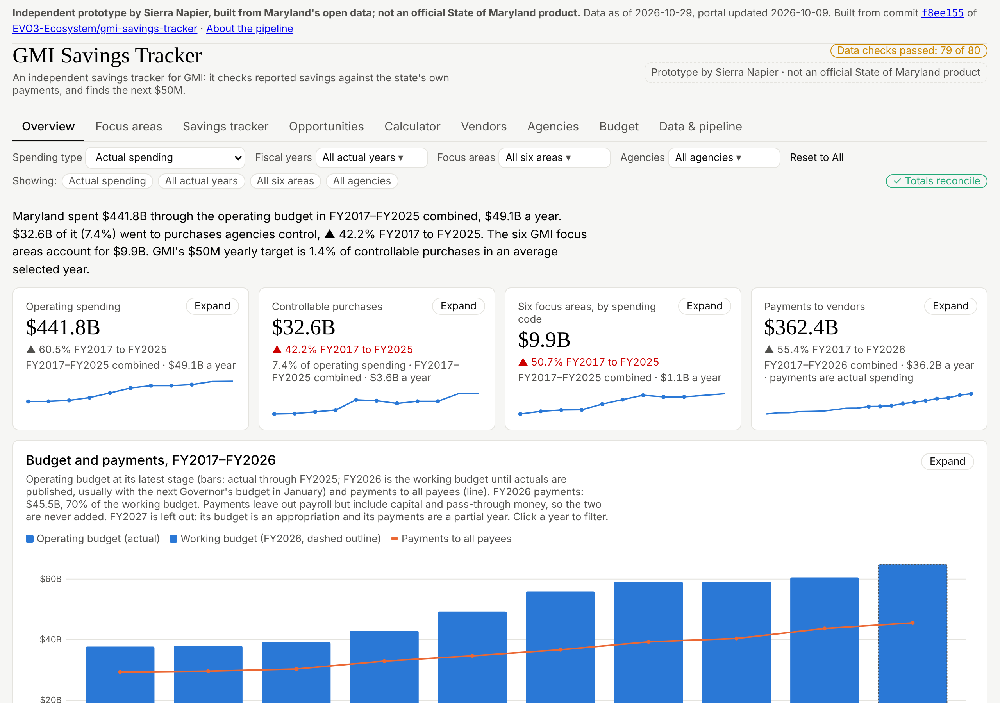
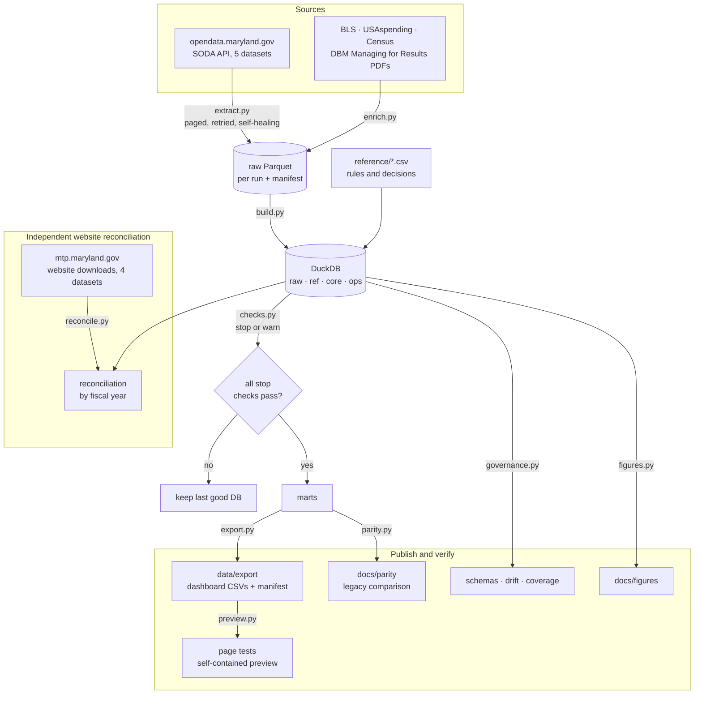
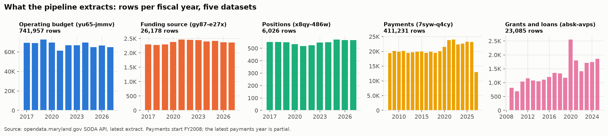
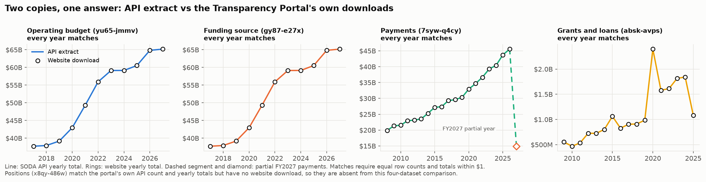
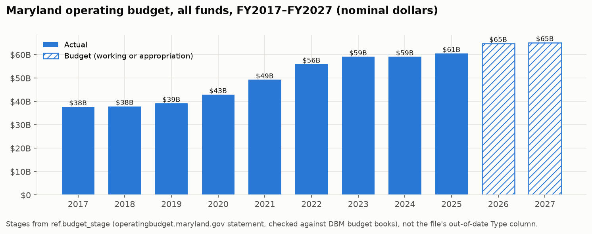
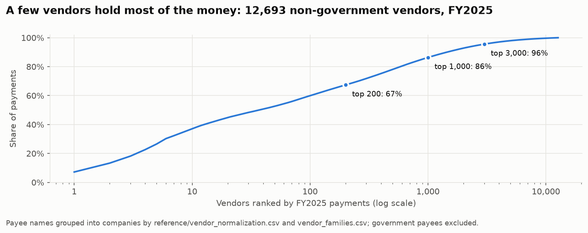
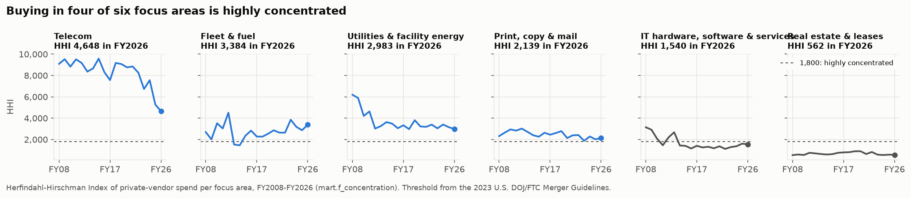

# GMI Savings Tracker v2

[](https://github.com/EVO3-Ecosystem/gmi-savings-tracker-v2/actions/workflows/ci.yml)
[](LICENSE)
[](https://evo3-ecosystem.github.io/gmi-savings-tracker-v2/)

An independent savings tracker for Maryland's Government Modernization Initiative (GMI): it checks reported savings against the state's own payments, and finds the next $50M. Prototype by Sierra Napier; not an official State of Maryland product.

## Live demo

**https://evo3-ecosystem.github.io/gmi-savings-tracker-v2/**: the dashboard, built by `make site` from the checked-in export snapshot in `site_data/` and published by `.github/workflows/pages.yml` on every push to `main`. GitHub Pages must be enabled once in Settings > Pages > Source: GitHub Actions. To refresh the published data: `make export && make site-snapshot`, then commit `site_data/`.



## What it found

- **Savings vs the goal:** GMI's quantified reported savings sum to $39.2M — $29.8M a year recurring plus $10.2M one-time — against the $50M-a-year goal (`reference/gmi_reported_savings.csv`). Checked against the state's own payments, only 2 of the 7 checks with a dollar figure show the saving; the $18M renegotiated-contracts claim's matching payments *rose* $10M ([docs/models/savings.md](docs/models/savings.md)).
- **Controllable spending and its forecast:** statewide controllable purchases were $4,093,855,308 in FY2025 and $4,820,212,979 in the FY2026 working budget (`data/export/latest/f_scope.csv`); the LightGBM challenger puts FY2026 at a $5.0B midpoint (80% range $4.5B–$6.8B) and beats the naive baseline on 1,083 of 2,609 series (`data/export/latest/d_challenger_total.csv`).
- **Review queue and revenue:** an Isolation Forest review queue holds 2,459 flags for analyst triage (`data/export/latest/review_queue.csv`), and the General Fund revenue corridor forecasts FY2027 at a $29.7B midpoint, 80% range $28.7B–$31.2B (`data/export/latest/f_revenue.csv`).


A free, local pipeline for Maryland's budget, payments, funding, staffing and grants data: SODA pulls → Parquet files → one DuckDB database → dashboard CSVs. It replaces the pipeline that built the **GMI Savings Tracker** and **Maryland Spend Lens** dashboards, whose original code is saved here under `legacy/`.

Data governance (sources, every table's schema, known source issues, assumptions, change control) is in [docs/data-governance.md](docs/data-governance.md), rebuilt with `make docs`. The plan and reference lists are also in the *Maryland Transparency Data — Dev Wiki* (Roadmap & build plan tab).

## How the pipeline works



### Datasets

All five datasets are extracted through the API and checked against the portal's own row count and yearly totals. The four datasets with a website download also get an independent, year-by-year website/API comparison (`make reconcile`; results in `docs/reconciliation/`). Positions has no website download to compare.

| Dataset | Portal ID | API rows | Website download | Years | Match |
|---|---|---|---|---|---|
| Operating budget | [yu65-jmmv](https://opendata.maryland.gov/d/yu65-jmmv) | 741,957 | mtp.maryland.gov | FY2017–FY2027 | every year |
| Funding source | [gy87-e27x](https://opendata.maryland.gov/d/gy87-e27x) | 26,178 | budgetsource.maryland.gov | FY2017–FY2027 | every year |
| Payments | [7syw-q4cy](https://opendata.maryland.gov/d/7syw-q4cy) | 411,231 | vendorpayments.maryland.gov | FY2008–FY2027 (FY2027 partial) | every year |
| Grants and loans | [absk-avps](https://opendata.maryland.gov/d/absk-avps) | 23,085 | grantsandloans.maryland.gov | FY2009–FY2025 | every year |
| Budgeted positions | [x8qy-486w](https://opendata.maryland.gov/d/x8qy-486w) | 6,026 | not on View Data | FY2017–FY2027 | Matches the portal's own count and yearly totals; no website download to compare |

Counts from the Nov 2, 2026 run. Not extracted: County Board of Education spending ([t6vk-rvwe](https://opendata.maryland.gov/d/t6vk-rvwe)), linked from the portal's menu; it covers county school boards, not State agencies. Full schemas, owners and known source issues are in [docs/data-governance.md](docs/data-governance.md).











The dashboard's Vendors tab is built on `sql/mart/34-39`: private vendors paid by 15 or more agencies, concentration (top-five share and HHI) by focus area, the largest vendors per area and companies paid under several names. It is scored against [docs/portfolio-rubric.md](docs/portfolio-rubric.md).

The website's budget download labels FY2021 "Working", FY2022 "Appropriation" and FY2027 "Governor's Allowance". The budget site's own statement and DBM's budget books say FY2021 and FY2022 are actuals and FY2027 is the Legislative Appropriation, so stages come from `reference/budget_stage.csv` (`docs/reconciliation/budget_stage_labels.csv`).

## Status

| Phase | State | Gate |
|---|---|---|
| 1. Extract | **Done** (Oct 28, 2026) | Two runs in a row matched portal row counts for all five datasets ✔ |
| 2. Database | **Done** (Oct 29, 2026) | 30 of 30 checks pass; all five datasets' yearly totals tie to the portal to the cent ✔ |
| 3. Reference data | **Done** (Oct 29, 2026) | Match rates equal the dashboard's; controllable purchases and focus areas FY2025 match it to the dollar ✔ |
| 4. Marts & dashboard | **Base files done** (Nov 2, 2026) | 21 dashboard files: 12 reproduced exactly, 9 differences explained (`docs/parity/`) ✔; vendor, budget and overlap marts added since; analytics files move with Phase 5 |
| 5. Analytics | **Phase 3 ML build-out done** (Nov 9, 2026) | All 53 dashboard files come from the database; none is carried. LightGBM quantile challenger with rolling-origin adoption (1,083 of 2,609 series) and a simulated statewide FY2026 corridor; Isolation Forest review queue (2,459 flags) with per-flag review status; General Fund revenue corridor (FY2027 midpoint $29.7B, 80% range $28.7B–$31.2B); K-Means agency peer clusters behind the consolidation treemap; spending-to-results mart (2,367 MFR measures). 100 build checks (99 pass, 1 measured-calibration warning), 36 dashboard page tests and the full pytest suite green. Cross-checks against the state sites and the detector backtest remain open |
| 6. Automate & document | — | Two clean scheduled runs with no manual steps |

Next up is Phase 5a: replace the Data & pipeline tab's old-pipeline facts, port the cross-checks, and make `export.py` refuse a failed build. The full gap list and a phase timeline are in [docs/roadmap.md](docs/roadmap.md).

CI (lint, compile check, tests) was red from Nov 2 to Nov 6, 2026: the editable install exposed `pipeline` instead of `src`, so `from src.pipeline import ...` failed at test collection. Fixed by declaring the packages in `pyproject.toml`; `main` is green again.

## Run it

Python 3.10 or newer.

```bash
pip install -e ".[dev]"   # runtime dependencies, pytest and ruff (what CI installs)
make extract        # download what changed since the last good run
make extract-full   # download everything
make gate1          # Phase 1 gate: last two runs matched the portal
make build          # Phase 2: DuckDB layers + checks (non-zero exit on a failed check)
make all            # extract then build
make test           # CI runs the same; data-dependent tests skip when data/ is absent
make test-fault     # damage a copy of the raw run and check the build fails and keeps the last good database
make snapshot       # portable Parquet snapshot of the database in data/snapshots/ (manifest with row counts and checksums)
make restore SNAP=data/snapshots/<folder>   # verify checksums, import, check row counts (RESTORE_FLAGS=--force to replace)
make export         # dashboard CSVs; refused unless every stop check passed and parity has no unexplained difference
make parity         # compare the marts with the legacy dashboard files (LEGACY=path to the old out/ folder)
python -m src.pipeline.export                      # all 44 dashboard CSVs from the marts into data/export/ (no legacy files needed)
python -m src.pipeline.preview                     # dashboard page tests on the export, then a self-contained preview
make reconcile      # compare four website downloads with the API (about 750 MB; RECONCILE_FLAGS=--reuse)
make figures        # rebuild figures; database-backed charts require data/md_transparency.duckdb
make diagrams       # render pipeline.png and data_hierarchy.png from their Mermaid sources (needs mmdc)
make docs           # data governance: schemas, coverage, drift
```

An app token is optional: copy `.env.example` to `.env` and set `MD_SODA_APP_TOKEN`. Without one, a full download takes about 2.5 minutes; a run where nothing changed takes about 4 seconds.

## Phase 1: extract (`src/pipeline/extract.py`)

For each dataset in `config/datasets.yaml` (budget yu65-jmmv, fund gy87-e27x, fte x8qy-486w, payments 7syw-q4cy, grants absk-avps):

1. Reads the portal's `rowsUpdatedAt`, its own `count(*)` and its own per-year totals.
2. **Freshness check:** if `rowsUpdatedAt` is unchanged since the last good run, reuses that run's Parquet (hard link) instead of downloading.
3. Otherwise downloads 20,000-row pages ordered by `:id`, retrying each page with exponential backoff (50,000-row pages drop without a token).
4. **Self-healing:** if the file's row count differs from the portal's, re-downloads it (up to twice), re-reading the portal's count in case it changed mid-run. Tested with `EXTRACT_FAULT=fte`, which drops half the rows: the run repaired it and passed.
5. Writes `data/raw/<run_id>/<dataset>.parquet` and `manifest.json` (rows, portal count, match, `rowsUpdatedAt`, source, seconds, repairs, per-year portal totals for the Phase 2 totals check).
6. **Feedback loop:** every run, including failed ones, is appended to `data/runs.csv`. A failed run exits non-zero and is never reused.

Gate runs, Oct 28, 2026 (1,208,477 rows each):

| Run | Mode | Time | Result |
|---|---|---|---|
| 20261028T202434Z | first download | 168 s | all five match |
| 20261028T202736Z | forced download, test fault in fte | 148 s | fte repaired by re-download; all five match |
| 20261028T203005Z | freshness check (portal unchanged) | 3.5 s | all five reused and match |

Budget (11 years) and payments (20 years) per-year sums from the downloaded files equal the portal's own totals to the cent.

## Phase 2: database (`src/pipeline/build.py`, `checks.py`)

Builds `data/md_transparency.duckdb` from a run's files in about 9 seconds: `raw` (as delivered), `ref` (agencies, functions, objects, sub-objects, fund types, budget stages), `core` (typed and normalized facts, plus CPI by fiscal year, federal awards, population, and the Managing for Results document index), `ops` (source snapshot, portal yearly totals, enrichment status, check results, run log). Every check is recorded in `ops.check_result` and `data/check_history.csv`. A failed stop check exits non-zero and **keeps the last good database**; the failed build is saved as `md_transparency.failed.duckdb` for inspection (tested by faking a one-row mismatch).

Context sources pulled with each extract (`src/pipeline/enrich.py`, warnings never block): CPI-U (BLS, falling back to FRED when BLS's shared daily limit is hit), federal grants to Maryland governments (USAspending), Maryland population (Census estimates), and every agency's Managing for Results plan (DBM, 111 PDFs for FY2027). See `docs/recommendations.md`.

## Phase 3: reference data (`reference/*.csv`, `src/pipeline/reference.py`)

Every rule the dashboard pipeline kept in code now lives in a CSV, so each change has an author and a date: payment agency rules and decisions, vendor families and normalization, payee focus areas, controllable-purchase rules, focus-area rules, budget stages, GMI's 14 reported savings items, the Managing for Results plan-to-agency map, and the dashboard's quality baseline. `reference.py` applies them to build `ref.map_payment_agency`, `ref.map_payee_vendor`, `ref.map_focus_area`, `core.fact_payment_mapped`, `core.fact_budget_scope` (controllable flag, scope and focus area per budget line) and `core.mfr_measure` (every performance measure and yearly value read from the plans). Results, Oct 29, 2026:

| Measure | Pipeline | Dashboard |
|---|---|---|
| FY2026 payment dollars matched to a budget agency | 100.00% | 100.00% |
| Payment agency names mapped | 143 of 145 (141 on Oct 29, before the Nov 4 agency decisions) | 141 of 145 |
| Payee names grouped into multi-name companies | 9,686 in 4,478 (all years) | 9,474 in 4,377 (FY2026 payees) |
| Controllable purchases, FY2025 | $4,093,855,308 | $4,093,855,308 |
| Focus areas, FY2025 | $1,287,718,788 in 96 codes | $1,287,718,788 in 96 codes |
| Managing for Results | 2,957 measures, 106 of 111 plans matched to an agency | — |

## Layout

```
.github/                 CI, manual extract smoke test, issue and PR templates
docs/                    roadmap, checks, data sources, data governance, portfolio rubric and recommendations,
                         schemas/, reconciliation/, parity/, figures/
scripts/bootstrap_github.sh  one-time labels, milestones and phase issues
config/datasets.yaml     dataset IDs, page size, retries, backoff, heal attempts
config/dashboard.yaml    the dashboard's data files: columns, keys and which mart builds each
reference/               hand-kept CSVs (16): agency, vendor, payee-type, focus-area and budget-stage rules and decisions, GMI's reported savings, stage evidence
sql/mart/                one SQL file per mart (44), run in order by marts.py
src/models/              challenger (LightGBM quantile), anomaly (Isolation Forest), revenue, clustering (K-Means)
src/pipeline/            extract, enrich, build, checks, reference, marts, parity, export, preview,
                         reconcile, figures, governance
tests/                   pytest checks (data-dependent ones skip when data/ is absent)
data/                    git-ignored: raw/<run_id>/, runs.csv, md_transparency.duckdb, export/
legacy/gst/              the original GMI Savings Tracker pipeline (see below)
```

## Legacy pipeline (`legacy/gst/`) — the spec for phases 2–5

The code that built the GMI Savings Tracker (pandas, not DuckDB). Run order, from `scripts/run.py`:

| Order | Script | What it does |
|---|---|---|
| 1 | `common.py` | Paths, HTTP with retries, SODA paging, the run log and checks |
| 2 | `sources.py` | Downloads the five datasets per year, reconciles each year to the portal's count and sum, re-downloads mismatches |
| 3 | `budget_legacy.py`, `payments_legacy.py` | Earlier Spend Lens logic reused: controllable-purchase rules, focus-area tagging by payee name, pass-through exclusions |
| 4 | `model.py` | Budget model, official stage labels read from operatingbudget.maryland.gov, agency master list (payment names → budget codes), **vendor master list rules** (`FAMILIES` regex and spacing merges), payments model, agency-year table |
| 5 | `measures.py` | Year-over-year measures (DAX-style), catalog |
| 6 | `savings.py` | GMI reported savings (Joint Chairmen's Report, Jan 26, 2026) and the payee-name payment check for each item |
| 7 | `opportunities.py` | Four savings detectors (peer gap, growth above trend, tail spend, leverage) |
| 8 | `forecast.py` | Backtested forecasts (trend, naive, drift) with bootstrap intervals; GMI-rate defaults; General Fund shares |
| 9 | `recs.py` | Recommendation outputs: bid list, vendor drill-downs, contract candidate sets, savings status history, path to $50M, master list quality |
| 10 | `run.py` | Orchestrates 2–9, runs ~90 checks, publishes only if none fail, records run history |
| 11 | `page_test.py` | Renders the dashboard page in headless Chromium across filter combinations and checks totals reconcile |
| 12 | `report.py` | Optional PDF report of the dashboard |

`page/index.html` is the dashboard page; `deploy/powerbi/measures.dax` holds the same measures for Power BI; `stage_evidence.csv` records how the budget stage of each year was confirmed.

## Pipeline versioning with DVC (local only)

DVC is initialized with `--no-scm` and a local-only default remote at `../gmi-dvc-store` (created by `dvc remote add -d localstore ../gmi-dvc-store`; no cloud, per the low-cost rule).
`dvc.yaml` declares the four stages — `extract`, `build`, `checks`, `export` — calling the same `src.pipeline` entry points as the Makefile; `dvc repro --dry` prints the plan without running it.
`data/` stays out of git via `.gitignore` exactly as before; DVC versions the declared outputs (`data/raw`, the DuckDB database, `data/export`) into the local store instead.
Push and pull with `dvc push` / `dvc pull`; inspect the pipeline with `dvc dag`.
`.dvcignore` keeps caches, the venv and transient side files (WAL, in-progress and failed databases) out of DVC's scans.
The optional `make postgres` target (needs `DATABASE_URL`) and the read-only MCP server live in `mcp_server/` — see [mcp_server/README.md](mcp_server/README.md).

## Community and standards

Contributions are welcome: start with [CONTRIBUTING.md](CONTRIBUTING.md), the [Code of Conduct](CODE_OF_CONDUCT.md), and [SECURITY.md](SECURITY.md) for reporting vulnerabilities. How the project is run: [GOVERNANCE.md](GOVERNANCE.md) · where to get help: [SUPPORT.md](SUPPORT.md) · releases: [CHANGELOG.md](CHANGELOG.md).

Every standard this repo follows, with citations — open-data principles (FAIR, the 8 Principles of Open Government Data, Open Data Charter), pipeline patterns, modeling references, and all primary data sources — is in [docs/best-practices.md](docs/best-practices.md). To cite the tracker itself, use [CITATION.cff](CITATION.cff) or the "Cite this repository" button.
