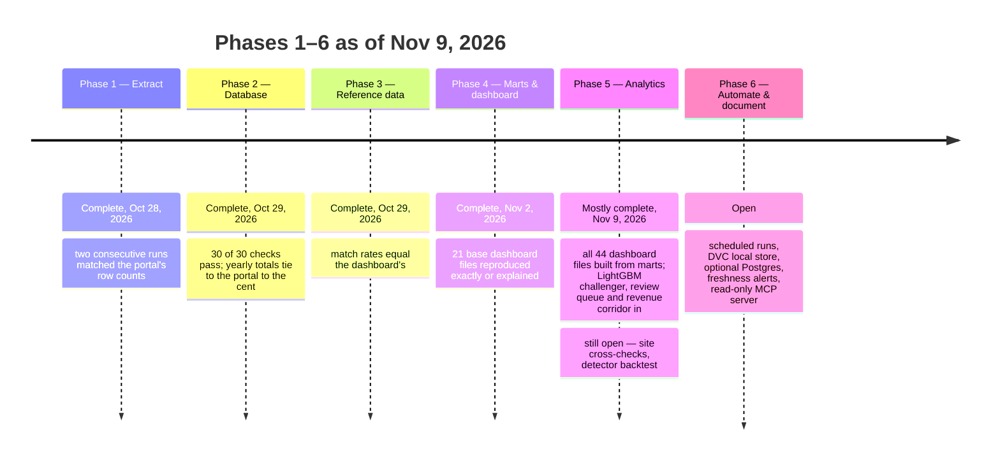

# Roadmap

Six phases over about eight weeks; each phase's gate must pass before the next starts. Full plan: the *Maryland Transparency Data — Dev Wiki*, Roadmap & build plan tab.

| Phase | Weeks | Build | Gate | Status |
|---|---|---|---|---|
| 0. Align | done | Data dictionary, gap analysis, API references, reference lists | Team signs off on definitions | Done |
| 1. Extract | 1 | `extract.py`: 20,000-row pages by `:id`, retries, freshness check on `rowsUpdatedAt`, Parquet per run, manifest with portal counts and totals | Two runs in a row match portal row counts | **Passed Oct 28, 2026**; context sources added Oct 29 |
| 2. Database | 2–3 | DuckDB `raw`, `core`, `ops`; type casting and code normalizing; reconciliation checks; non-zero exit on failure | Every check passes; yearly totals tie to the portal | **Passed Oct 29, 2026** (30 of 30) |
| 3. Reference data | 3–4 | `ref` layer from `reference/` CSVs: agencies and aliases, stages, focus areas, payment-name and vendor maps; match-rate report | Match rates at or above the dashboard's master list quality | **Passed Oct 29, 2026** |
| 4. Marts & dashboard | 4–5 | One `mart` table per dashboard file; `export.py` writes the CSVs; FY2027 payments as a partial year | Every dashboard file reproduced, or each difference explained | **Gate passed for the 21 base dashboard files (Nov 2, 2026).** `sql/mart/*.sql` (28 files at the gate, 43 now; the change measure applied by `marts.py` from each file's `-- yoy:` header), `make parity` against the legacy files: 12 reproduced exactly; 9 differ only as explained in `docs/parity/explanations.csv` (FY2027 partial year added; one company spelled differently). Also added: vendor master, payee types, agency functions, agency roll-up and results marts. Fixed on the way: scope precedence (client payments, then charges between agencies, then staff/grants/capital) and the payee-name pass-through exclusions (`reference/payee_area_exclusions.csv`). Left for Phase 5: the analytics files (opportunities, forecasts, savings checks, recommendations) and `export.py` |
| 5. Analytics | 5–7 | Forecasts, savings detectors, savings checks, path to $50M on the database; 5a first: pipeline facts, cross-checks, publish gate, fault test (gap analysis below) | Outputs match the dashboard; no carried files | **5a in progress (Nov 7, 2026):** publish gate, fault-injection test, database snapshot, the Data & pipeline facts and the forecasts (`f_forecast`, `d_forecast_model`) the opportunity detectors (`d_opps`, `d_bid_list`) the savings checks (`d_savings`, `f_savings_check`, `d_savings_status`, `d_vendor_moves`) and the recommendations (`d_plan50`, `d_rec_status`, `d_vendor_names`, `f_vendor_detail`), `measures` and `stage_evidence` done: **no dashboard file is carried any more (44 of 44 from marts, Nov 7, 2026)**. The gate's other half, outputs match the dashboard, has two supports: the dashboard's own 34 page tests pass against the 44-file export (every tab drawn, totals reconcile; run Nov 7, 2026 with `python -m src.pipeline.preview`, which needs Playwright and Chromium), and every ported module equals the legacy *scripts* on the same inputs. What is not done is a file-by-file comparison with the published legacy CSVs (not in the repo). Cross-checks against the state sites, the per-detector backtest and new-payee-name history are still open |
| 6. Automate & document | 7–8 | `make all`; launchd or cron on the Mac; run log, optional PDF report, wiki update | Two clean scheduled runs with no manual steps | |

## Open questions
- ~~Which decision for the 4 unmatched payment agency names?~~ Decided 2026-11-04 in `reference/payment_agency_decisions.csv` (two mapped, two excluded, each with evidence).
- ~~Is 4mca-332u (higher-education CUR and CR funds) already inside yu65-jmmv's totals?~~ No (checked 2026-11-04): it covers R13 Morgan State, R14 St. Mary's, R30 University System of Maryland and R95 Baltimore City Community College, which have no rows in yu65-jmmv ($8.6B in FY2026). Decision: add it in Phase 5 as its own raw table, union into the budget with a `source_dataset` column, show it in all-funds totals labeled "including public higher education", and leave it out of GMI savings baselines (these institutions buy under their own procurement authority, outside the executive-branch procurement GMI works through; confirm the statute citations before publishing).
- When to register the Socrata app token (before daily scheduling).

## Next phase suggestions: grants groupings
Grants are listed as published (`mart.f_grants`). Suggested groupings, each as a reviewed reference CSV:
- Grantor → budget agency code: uppercase, split at "/", map the agency part with the payment agency rules; unmatched names go to a decisions file.
- Grantor program: the text after "/" (for example WMATA operating vs capital grants).
- Grantee → vendor: the same normalization and company families as payments, so a grantee and a payee are one entity.
- Grantee type: the payee type rules (government, non-profit, business and so on) plus the dataset's non-profit flag.
- Purpose: cluster the description text into program families (cover crops, small business COVID loans, arts council grants).
- Overlap: match grants to payments on grantee, agency and year, and report grants outside payments separately.

## Old vs new pipeline: comparison matrix (Nov 5, 2026)

Old: `legacy/gst` (pandas scripts, CSV folders, about 2,000 lines of Python in 13 scripts). New: this repo (DuckDB layers, about 1,700 lines of Python plus 43 SQL marts). Status: **Better** = the new pipeline does more; **Same**; **Partial**; **Carried** = the dashboard file is still copied from the old pipeline; **Gap** = not in the new pipeline yet.

| # | Area | Capability | Old pipeline | New pipeline | Status |
|---|---|---|---|---|---|
| 1 | Extract | Download the five state datasets | `sources.py`: full download, reuse when the portal has not changed | `extract.py`: 20,000-row pages by `:id`, Parquet per run, manifest, freshness check on `rowsUpdatedAt` | Better |
| 2 | Extract | Self-healing | Re-downloads a year whose totals do not match | Re-downloads on a row-count mismatch, with backoff | Same |
| 3 | Extract | Match the portal's own counts and totals | Every year, every dataset | Every year (raw checks), plus `reconcile.py` against the portal's website downloads | Better |
| 4 | Extract | Cross-check with the state's sites | Budget vs operatingbudget.maryland.gov and payments vs vendorpayments.maryland.gov, 3 years each | Not ported | **Gap** |
| 5 | Extract | Budget stage evidence | FY2021-FY2022 programs vs DBM Volume 2 | `ref.budget_stage` (CSV with sources); `reference/stage_evidence.csv` (the legacy evidence file, carried over unchanged) checked on every build against the stage reference, the database's whole-year totals (FY2022 and FY2027 tie to the dollar) and DBM's printed actuals; the Volume 2 program comparisons themselves are not recomputed | Same |
| 6 | Extract | Context sources | None | CPI (BLS), population (Census), federal awards (USAspending), Managing for Results plans | Better |
| 7 | Extract | Datasets | 5 | 5, plus 4mca-332u (higher education) planned | Same (planned) |
| 8 | Storage | Layers | CSV folders: raw, staged, model, out | DuckDB: raw, ref, core, mart, ops | Better |
| 9 | Rules | Mapping and classification rules | Mostly in code (`model.py`, `payments_legacy.py`) | 15 reviewed CSVs in `reference/` (CODEOWNERS) | Better |
| 10 | Rules | Agency mapping | Rules plus fuzzy match; 4 names pending | Same rules from CSV; decisions with evidence; 0 pending | Better |
| 11 | Rules | Vendor names and companies | Normalization and families in code | CSV rules, vendor master, 7 payee types | Better |
| 12 | Model | Change measure (year over year) | `measures.py`, defined once | `marts.py` from each SQL file's `-- yoy:` header, same definition | Same |
| 13 | Model | The 21 base dashboard files | Built in pandas | SQL marts: 12 reproduced exactly, 9 differ only as explained (`docs/parity/`) | Same (proven) |
| 14 | Model | Vendors tab and portal views | None | 10 vendor marts; budget vs payments, funding sources, programs, grants as listed, overlap | Better |
| 15 | Analytics | Forecasts (trend vs naive vs drift, backtest, bootstrap band) | `forecast.py` | `src/models/forecast.py` (identical output on the real marts, tested against the legacy script), assumptions in `config/assumptions.yaml`, a rolling-origin backtest against the naive baseline, model card in `docs/models/forecast.md` | Better |
| 16 | Analytics | Opportunity detectors and bid list | `opportunities.py` (4 detectors) | `src/models/opportunities.py`: exactly the legacy output on the new marts (tested), thresholds in `config/assumptions.yaml`, a configurable minimum base for the growth detector, model card in `docs/models/opportunities.md` | Same |
| 17 | Analytics | Savings checks against payments | `savings.py` | `src/models/savings.py`: identical to the legacy output on the real payments (tested), items read from `reference/gmi_reported_savings.csv`, years and thresholds in `config/assumptions.yaml`, status history only from builds that pass, model card in `docs/models/savings.md` | Same |
| 18 | Analytics | Recommendations, path to $50M, history per run | `recs.py`, `model/rec_history.csv` | `src/models/recommendations.py`: the path to $50M and status rows 1-5 identical to the legacy functions on the real data (tested); recommendation 6 now read from this pipeline's Managing for Results data (the legacy text said "needs a data feed"); history in `data/rec_history.csv`, written only by passing builds; model card `docs/models/recommendations.md` shows how much of the path rests on assumptions | Better |
| 19 | Analytics | Vendor moves, payee-name detail, vendor pages | `payments_legacy.py`, `run.py` | `d_vendor_moves` ported with the savings checks (decreases only); `d_vendor_names` and `f_vendor_detail` ported with the recommendations, identical to the legacy function on both bases (tested) | Same |
| 20 | Quality | Master list quality | Computed each run | `mart.d_master_quality`, computed each build from `ref` (143 of 145 agency names mapped; lists the two still unmapped) | Same |
| 21 | Quality | Checks per run | 93 in 7 stages: raw 23, staged 3, model 14, cross-check 8, recommendations 7, page 28, publish 10 | 59 (raw 9, core 19, ref 11, mart 20) plus 34 page tests in `preview.py` | Partial: cross-checks and recommendation checks not ported |
| 22 | Quality | Fault-injection test | `run.py --inject-fault` drops half of FY2015 and shows the repair | `make test-fault` drops half of one budget year in a copy of the raw run and checks that the build fails its stop checks and the last good database survives (`tests/test_fault_injection.py`); the download re-fetch is shown by `EXTRACT_FAULT=fte` | Same |
| 23 | Quality | A failed check blocks publishing | Keeps the last good `out/` | Keeps the last good database; `export.py` refuses (exit 2) when a stop check failed, a newer build failed, or parity has an unexplained difference (`src/pipeline/gate.py`, `tests/test_gate.py`) | Same |
| 24 | Quality | Unit tests and CI | Page test only | 7 test files (14 tests), GitHub Actions CI and extract smoke test | Better |
| 25 | Quality | Parity with the old pipeline | n/a | `parity.py` with explanations | Better |
| 26 | Governance | Column definitions and schema drift | None | `governance.py`: 1,062 of 1,062 columns, drift history, governance doc | Better |
| 27 | Publish | Run log and checks on the dashboard | `pipeline_runs.csv`, `run_checks.csv` | `mart.pipeline_runs` (extract runs joined to each build's check counts) and `mart.run_checks` (every check of the build), written by `export.py`; run history comes from `data/runs.csv` and `data/check_history.csv` | Better |
| 28 | Publish | Dashboard data files | Written to `out/` | `export.py` with a manifest and a "changed since last export" flag, plus a tested preview | Better |
| 29 | Publish | PDF report | `report.py` | None (optional end-user feature) | Gap (optional) |
| 30 | Publish | Power BI measures | `deploy/powerbi/measures.dax` | None | Gap (low) |
| 31 | Run | Scheduling | Manual | Manual locally; CI on GitHub | Same (Phase 6) |
| 32 | Docs | Figures | None | `figures.py`: 5 PNGs from the database | Better |

Summary of the 32 rows: 16 Better, 12 Same, 1 Partial, 0 Carried, 3 Gap (one optional, one low priority). **All 44 dashboard files come from the new marts; none is carried.**

## Gap analysis and improvement backlog (Nov 5, 2026)

Ordered by value for the dashboard and the interview. Effort: S = under a day, M = one to three days.

| # | Gap | Why it matters | Fix | Effort | Phase |
|---|---|---|---|---|---|
| 1 | The Data & pipeline tab shows the old pipeline's facts (rows 20, 27): 93 of 93 checks, the four agency names already decided, the corrected grants "$50,000" claim | A reviewer sees numbers that contradict the repo; integrity scores 2 of 5 | Marts for `sources`, `runs`, `checks`, `measures`, `d_master_quality` and `stage_evidence` from `ops` and `ref`; show new and old check counts during the switch | S | 5a **done Nov 7:** `sources`, `runs`, `checks` and `d_master_quality` (`src/pipeline/facts.py`); `measures` is generated from the `-- yoy:` headers of the mart SQL, so it cannot drift from the columns it describes; `stage_evidence` is a reference file checked against the stage reference and the database. New and old check counts are not shown side by side |
| 2 | Analytics still carried (rows 15-19) | Calculator, Opportunities and Savings tracker score 3 only because of this | Port to `src/models/` on the marts: baselines first, backtest FY2017-FY2022 → FY2023-FY2025, seeded bootstrap, assumptions in `config/assumptions.yaml`, model cards in `docs/models/`; parity against the old files | M per module | 5 |
| 3 | No cross-checks with the state's own sites (row 4) or DBM budget books (row 5) | The old pipeline proved totals against three independent publications; the new one against two | Port the 8 cross-checks into `checks.py` (warn if a site is down, stop if a total differs) | S | 5a |
| 4 | Publishing is not gated (row 23) | A bad build could still be exported | `export.py` exits non-zero if the latest run has a failed stop check or parity has an unexplained difference | S | 5a **done Nov 7** |
| 5 | No history of recommendations or new payee names (row 18) | The "changed since last refresh" feedback loop is lost | `ops.rec_history` and `ops.payee_name_seen`, appended each run | S | 5 **partly done Nov 7:** the savings status history (`data/savings_status_history.csv`) and the recommendation history (`data/rec_history.csv`) are kept, appended by builds that pass; new payee names remain |
| 6 | No fault-injection test (row 22) | Self-healing is claimed but not demonstrated | `make test-fault`: drop rows from one year in a copy of raw and show the check fails and the last good database is kept | S | 5a **done Nov 7** |
| 7 | Analysis quality from the tab review: small-base changes (+4,177%, +42,462%), nominal dollars only, nine-year sums in Overview tiles | Over-reading risk; executives read one year | Minimum base for changes (about $1M); real and per-resident dollars (`core.cpi_fy`, `core.fact_population`); FY2026 vs FY2025 tiles | M | 5 |
| 8 | Higher education budget (4mca-332u) not loaded | All-funds totals leave out about $8.6B a year | Raw table, `source_dataset` column, labeled totals, kept out of savings baselines | M | 5 |
| 9 | Grants have no groupings; overlap is a name-match minimum | WMATA, the largest grants, show no match | Grantor and grantee groupings (see "Next phase suggestions") | M | 5-6 |
| 10 | Model tidy-ups noted earlier | `core.fact_fund` drops unit and program; `mart.payment_area` holds payment lines | Keep unit/program; rename to `mart.payment_line` | S | 5 |
| 11 | Page speed | The 4.5 MB grants file loads with everything else | Load it only when the Budget tab opens | S | 5 |
| 12 | Power BI measures, PDF report (rows 29-30) | Nice to have | Generate DAX from `config/dashboard.yaml` measures; port `report.py` | S each | 6 (optional) |
| 13 | Scheduling (row 31) | Monthly refresh is manual | `make all` on a schedule; register the Socrata app token first | S | 6 |

Tab scores (rubric in `docs/portfolio-rubric.md`, Nov 5, 2026): Overview 3, Focus areas 4, Savings tracker 3, Opportunities 3, Calculator 3, Vendors 5, Agencies 3, Budget 3, Data & pipeline 2. Gaps 1, 3, 4 and 6 lift Data & pipeline; gap 7 lifts Overview, Agencies and Opportunities; gap 2 lifts the three analytics tabs.

Dashboard-level gaps added in the *GMI Dashboard Optimization Roadmap v2* (Claude Docs, Nov 5, 2026), which supersedes the Dev Wiki's v1 roadmap tab:

| # | Gap | Fix | Effort | Phase |
|---|---|---|---|---|
| 14 | Overview tiles add nine years; 7 dense cards | FY2026 vs FY2025 tiles with stage labels; one-line conclusion; scope chart moves to Focus areas | S | 5a |
| 15 | Savings tracker repeats two tables; 50% tolerance unlabeled | Merge the tables; label the tolerance where "Seen" appears | S | 5a |
| 16 | Opportunities headline reads as a promise; detectors untested | "Leads worth up to"; backtest each detector | M | 5 **partly done Nov 7:** detectors ported with exact parity and tested on constructed cases; measured that 38% of the growth detector's value is growth of 1,000%+ (likely re-coding) and that totals are not additive; headline wording and the backtest remain open |
| 17 | Agencies: one table, no chart or headline; pass-through agencies top per-position | Ranked chart, headline, pass-through flag | S | 5a |
| 18 | Budget cards lack conclusions; no funding chart; tall grant rows | One-line finding per card, funding chart, one-line descriptions | S | 5a |

## Roadmap v3 additions (Nov 5, 2026): outside review and portfolio harvest

**Review check.** An outside review of this repo was right that CI is failing (every push from Nov 2 to Nov 6, 11 runs in a row; last green Oct 29) but wrong about the cause: the error is `ModuleNotFoundError: No module named 'src'` at test collection, not network calls. The root cause was packaging, not the pytest import path: setuptools auto-discovery exposed `pipeline` instead of `src` in the editable install, and `tests/test_governance.py` (Nov 2) was the first test to import `src.pipeline`. **Fixed Nov 6, 2026** by declaring `src` and `src.pipeline` in `pyproject.toml` (PR 6); `main` is green again. PR 7 untracked the stale `src/*.egg-info` and set read-only workflow token permissions. Still open: require the `test` check on `main` (branch protection, a repo setting) and bump the Node 20 actions (`checkout@v4`, `setup-python@v5`), which only warn. It also described the repo as static CSVs or SQLite, which it isn't, and said Phase 5 must reproduce the 21 base files, which are already reproduced.

**Ideas register.** 49 unique ideas from the review: 9 done, 25 adopt, 9 adapt, 6 decline. Declined, with reasons: OData (SODA covers it), subcontractor data (no public source), State Police dashboard (out of scope), Prophet or Orbit seasonality (annual data only), random forest fiscal-stress classifier (no labeled stress events), switching to Seaborn or Plotly (d3 and matplotlib already use the validated palette). ~~Revenue forecasting~~ was declined for lack of revenue data; **reversed Nov 9, 2026**: a sourced General Fund revenue history (FY2017–FY2026, Comptroller closeouts and Board of Revenue Estimates reports, row-level citations in `reference/gf_revenue_history.csv`) made it possible, and `src/models/revenue.py` now forecasts FY2027 with a rolling-origin backtest against the naive baseline.

**Phase 3/5 build-out, Nov 9, 2026.** The analytics layer is in place: the LightGBM quantile challenger (`f_challenger`, adopted for 1,083 of 2,609 agency x code series where it beats naive in rolling validation), a simulated statewide FY2026 corridor (`d_challenger_total`: $4.5B–$6.8B around a $5.0B midpoint, against the $4.8B working budget), the Isolation Forest review queue (`review_queue`: 2,459 flags at 3% contamination, with per-flag review status on the Opportunities tab), the General Fund revenue corridor (`f_revenue`: FY2027 midpoint $29.7B, 80% range $28.7B–$31.2B), agency peer clusters (`agency_clusters`: K-Means on spending mix, k = 3 by silhouette with a no-singleton rule) drawn as the consolidation treemap, and the spending-to-results mart (`results_trend`: 2,367 MFR measures with 3+ actual years next to real budget change; endpoint ratios beyond 20x dropped as parse artifacts). A new Forecasts & results tab carries the corridors and the results table; the header shows a portal-freshness pill off `sources`. 100 build checks (99 pass, 1 warning — forecast calibration measured in-sample), 36 dashboard page tests, and the full pytest suite are green.

| Step | Adds | Gate |
|---|---|---|
| Done (Nov 6) | CI package discovery fix | Green CI on main ✔ |
| 5a | SODA fixtures and no-network tests; fixture integration test; contract tests on exports; README diagram, screenshots and findings; executive cards (forecast range, savings vs $50M, review queue); Agencies scatter and box plot; Budget treemap; job description crosswalk (after checking the posting) | CI green on fixtures; nothing stale; export refuses a failed build |
| 5 | Rolling-origin backtests; P10-P90 ranges with coverage; LightGBM quantile challenger on agency x code x year; log and real-dollar transforms; robust scaling; Isolation Forest on vendor-agency-year patterns; agency peer clusters (K-Means/HDBSCAN) with a PCA map; grant-description clustering; review queue with status (Under review, Approved variance, Refer to OLA) and CSV export; State Plan priorities and OLA findings as reference data; BLS employment and BEA GDP context; program-level drill-down | 0 carried files; models beat or match baselines; every tab 5 of 5 |
| 6 | DVC with a local store; optional `make postgres`; freshness alerts as GitHub issues; read-only MCP server over the marts; NAICS and contract-award research (eMMA, SAM.gov); analyst-detail toggle; roadmap timeline figure | Two clean scheduled runs |

**Portfolio harvest** (patterns from the owner's other repos, `snapaiarchitect/sierra-applied-ml` and `snapaiarchitect/genai-engineering`):

| From | Pattern | Lands as | Phase |
|---|---|---|---|
| sierra-applied-ml | GitHub Pages live site with interactive pages | Public preview of the dashboard and a project page | 6 |
| sierra-applied-ml | README order: problem, what it means, results vs baseline, one finding per chart, provenance | README rewrite | 5a |
| sierra-applied-ml | Baseline-first results tables, holdout periods | Model card template | 5 |
| genai-engineering | Docker and docker-compose one-command launch | `docker compose up` runs pipeline and preview | 6 |
| genai-engineering | Model registry with lineage | `ops.model_registry` in DuckDB | 5 |
| genai-engineering | Drift detection (KS test, PSI) | Check comparing this run's payment distributions with the last | 5 |
| genai-engineering | Promote only if better than baseline | Stop check before a model is published | 5 |
| genai-engineering | Confidence threshold to human review | Low-confidence flags go to the review queue | 5 |
| genai-engineering | TF-IDF + logistic regression classifier | Payee-type classifier trained on rule-labeled payees, to catch rule misses; grant description groups | 5 |

**Portfolio housekeeping done Nov 5, 2026:** genai-engineering README counts and claims corrected to its data files (pushed); sierra-applied-ml README corrected to its results files and its links moved to snapaiarchitect (patch ready; this session can't push to that repo); profile README in `snapaiarchitect/snapaiarchitect` links all three repos (pushed; the repo is private, so it shows on the profile only once made public). Pinning is a manual step on GitHub.

## Best practices applied and planned (Nov 7, 2026)

Researched for each open suggestion; what is done is marked, the rest is the standard Phase 5 will follow.

| Area | Practice | Status |
|---|---|---|
| Publishing | Write-audit-publish: stage, audit, publish only if the audit passes ([overview](https://www.tabular.io/?p=549), [orchestration example](https://docs.coginiti.co/tutorials/wap-awap-tutorial/)) | Done: `gate.py` gates `export.py`; the build already keeps the last good database |
| Persistence | Export with `EXPORT DATABASE` to Parquet and import into an empty database ([DuckDB docs](https://duckdb.org/docs/stable/sql/statements/export)); never copy a file that is open for writing | Done: `make snapshot` / `make restore` with a manifest and SHA-256 per file; copy the folder to storage outside the sandbox to keep it |
| Fault injection | Damage an input on purpose and show the checks catch it and nothing bad is published | Done: `make test-fault` |
| Actions security | Read-only default token, third-party actions pinned to full commit SHAs with a version comment, `persist-credentials: false`, Dependabot to keep pins current ([guide](https://boostsecurity.io/blog/how-to-secure-github-actions), [pinning notes](https://medium.com/@jordanritter/security-hardening-github-workflows-at-scale-d291a33774e1)) | Done: all three actions at v7 (Node 24), pinned; `.github/dependabot.yml` added |
| Forecast evaluation | Rolling-origin (walk-forward) evaluation, never shuffled folds; every model compared with the naive last-value baseline on the same origins and horizons; MASE scale from each origin's own training history ([tsCV](https://pkg.robjhyndman.com/forecast/reference/tsCV.html), [workflow](https://metricgate.com/blogs/workflow-for-validating-a-forecasting-model/), [Cerqueira et al. 2020](https://web3.arxiv.org/abs/1905.11744), [Hyndman and Koehler 2006](https://www.doi.org/10.1016/J.IJFORECAST.2006.03.001)); ranges judged by coverage and the interval score ([Gneiting and Raftery 2007](https://apps.dtic.mil/sti/html/tr/ADA459827/index.html)) | Done for the forecasts (Nov 7): the model is chosen by rolling-origin MASE (changes Utilities from drift to naive), an equal-weight combination was scored and not adopted, and the ranges were measured: they cover 63.5% against a nominal 80% (warning on every build; ranges left as published, the owner's decision). Full sources and what was verified: `docs/models/forecast.md` |
| Branch protection | Require the `test` check on `main` | Open: a repository setting only an admin can change. Steps: Settings > Rules > Rulesets > New branch ruleset, target `main`, enable "Require status checks to pass" and add `test` ([GitHub docs: about protected branches](https://docs.github.com/en/repositories/configuring-branches-and-merges-in-your-repository/managing-protected-branches/about-protected-branches)) |

## Remaining phases to completion (Nov 9, 2026)

With Phase 3 (ML analytics) and the v2 dashboard merged, what is left, in order:

**Phase 5 closure — analytics depth (1-2 working sessions)**
1. Detector backtest on the dashboard: `mart.d_detector_backtest` (detectors rerun as of FY2022-FY2024, flags followed one year) is built but not yet drawn; add a hit-rate card to the Opportunities tab and finish idea #16's headline wording ("leads worth up to").
2. Cross-checks against the state sites (MD funding portal, eMaryland Marketplace) for a sample of findings; record in `reference/`.
3. Macro regressors for the challenger and revenue models: BLS employment and BEA regional GDP (CPI already loaded); re-run rolling-origin adoption afterwards.
4. Payee-type classifier (TF-IDF + logistic regression trained on rule-labeled payees) to catch rule misses, and grant-description clustering for overlap with contract spending.
5. Review-queue CSV export from the page (status is currently stored in the browser only).
6. `ops.model_registry` (model, training window, backtest score, adopt/discard) and a drift check (KS/PSI) comparing each run's payment distributions with the previous run.
7. PCA scatter companion to the consolidation treemap (optional; the treemap already carries the groups).

**Phase 6 — automate and publish (the demo path)**
1. Merge the Phase 3 PR; the Pages workflow (`pages.yml`) then rebuilds the site from `site_data/` on every push to main.
2. One admin step in repo Settings: Pages > Source > GitHub Actions. The dashboard is then live at `evo3-ecosystem.github.io/gmi-savings-tracker`.
3. Monthly freshness loop: a scheduled workflow that runs extract + build + export + `make site-snapshot` and opens a PR when the portal's `rowsUpdatedAt` moves; failed stop checks open a GitHub issue instead of publishing.
4. Branch protection on `main` (require the `test` check; admin setting).
5. Optional: `make postgres`, DVC local store, read-only MCP server over the marts, `docker compose up`, NAICS/eMMA/SAM.gov contract research, analyst-detail toggle, roadmap timeline figure, PDF report, Power BI measures.

**Gates that already exist and stay in force:** export refuses a failed build; every model must beat or match its naive baseline or it is not adopted; page tests (36) and pytest (150+) run before any publish; every column documented (1,518/1,518).
